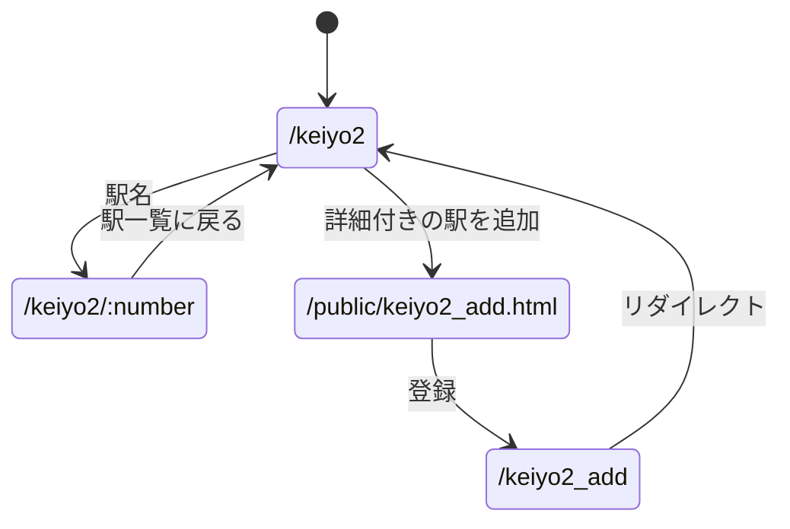

# 第7〜9回 演習の説明

## 第7回：フォーム

`input` の `type` は、入力欄の種類や動きを決める。例えば `radio` は選択肢、`number` は数値入力、`hidden` は画面に表示せず送る値に使う。

`name` は送信する項目の名前。今回のラジオボタンはすべて `name="hand"` なので1グループになり、選んだボタンの `value` をサーバで `req.query.hand` として受け取る。

`id` はページ内で入力欄を識別する名前。ラジオボタンにはそれぞれ異なる `id` を付け、`label` の `for` と対応させる。これで文字をクリックしても選べる。

表示内容が固定ならHTMLを使う。サーバで計算した値や配列の内容によって表示が変わる場合はEJSを使う。今回の最初の入力画面はHTML、手・勝敗・勝ち数が変わる結果画面はEJSにした。

勝ち数と試合数は、結果ページの `hidden` 欄に入れて次の送信に含める。勝ったときだけ勝ち数を1増やし、試合数は毎回1増やす。元の `/janken` とそのHTML・EJSは、課題の指示どおり変更していない。

## 第8回：一覧と追加

`/keiyo` は配列 `station` をEJSへ渡す。EJSの `for...of` で1件ずつ表示する。登録フォームからはID・駅コード・駅名が送られ、サーバは `req.query` で受け取って `station.push()` で追加する。

登録フォームでは、登録後に「一覧」か「入力画面」を選べる。一覧なら追加できた行をすぐ確認でき、入力画面なら連続して登録しやすい。第9回は新しい行をすぐ確認して詳細へ進めるよう、登録後に一覧へ戻る構成にした。

自由課題にはポケモン図鑑を使った。初期データは全国図鑑No.0001〜0009。図鑑番号・名前・タイプを表に表示し、フォームから分類・高さ・重さを含む1件を追加できる。登録後は一覧に戻り、名前をクリックすると詳細を確認できる。駅の詳細リンクは配列の添字、ポケモンの詳細リンクは重複しない図鑑番号を使う。

## 第9回：一覧から詳細

一覧の駅名をクリックすると、例えば `/keiyo2/1` を開く。最後の `1` は駅IDではなく、配列の添字（先頭を0とした番号）。サーバは `req.params.number` で受け取り、`station2[number]` の1件だけを詳細テンプレートに渡す。一方、`/keiyo2_add?id=8&...` のように `?` の後ろにある値は `req.query` で受け取る。

詳細用の追加フォームでは、ID・駅コード・駅名に加え、乗り換え線・乗車人数・距離を入力する。登録すると一覧に戻り、その駅名から追加した項目を確認できる。

| 項目 | 型 | 内容 |
| --- | --- | --- |
| `id` | 整数 | 重複しない正のID |
| `code` | 文字列 | 駅コード |
| `name` | 文字列 | 駅名 |
| `change` | 文字列 | 乗り換え線。空欄でもよい |
| `passengers` | 整数 | 乗車人数。0以上 |
| `distance` | 数値 | 東京駅からの距離（km）。0以上 |

駅データは授業資料の練習用データを使用した。
