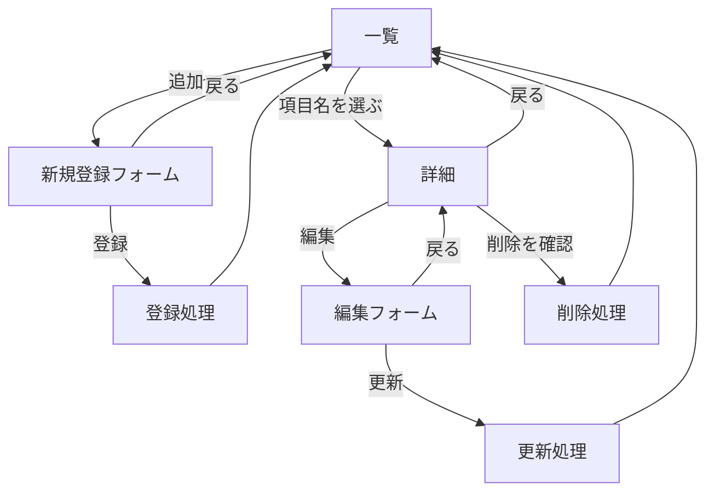

# 第10回 ページ遷移図

京葉線の駅一覧とポケモン図鑑は、共通の流れで登録・詳細表示・更新・削除を行う。削除は詳細画面で確認してから実行する。

| 画面・処理 | 京葉線の駅一覧 | ポケモン図鑑 |
| --- | --- | --- |
| 一覧 | `GET /keiyo2` | `GET /pokemon` |
| 新規登録フォーム | `GET /keiyo2/create` | `GET /pokemon/create` |
| 登録処理 | `POST /keiyo2` | `POST /pokemon` |
| 詳細 | `GET /keiyo2/:number` | `GET /pokemon/:number` |
| 編集フォーム | `GET /keiyo2/edit/:number` | `GET /pokemon/edit/:number` |
| 更新処理 | `POST /keiyo2/update/:number` | `POST /pokemon/update/:number` |
| 削除処理 | `POST /keiyo2/delete/:number` | `POST /pokemon/delete/:number` |

京葉線の `:number` は配列内の位置で、ポケモン図鑑の `:number` は図鑑番号。両アプリともデータをサーバの配列で管理する。サーバを再起動すると初期データに戻る。
