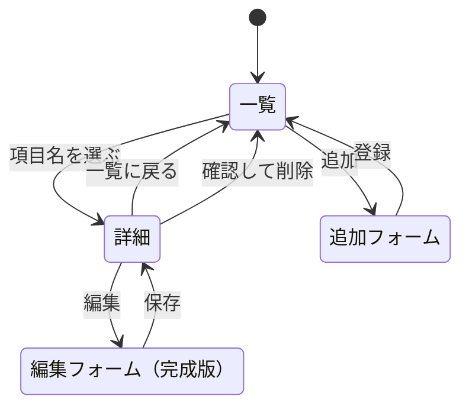

# 第9回：データ表示アプリの設計

レポート用の題材は、ポケモン図鑑、千葉工大ツイッタラーデータベース、ダーツ練習記録の3つ。第8回の自由課題と第9回の詳細表示の練習にはポケモン図鑑を使う。

## 利用者向け

| アプリ | 一覧で見るもの | 詳細で見るもの |
| --- | --- | --- |
| ポケモン図鑑 | 図鑑番号、名前、タイプ | 分類、高さ、重さも表示 |
| 千葉工大ツイッタラーデータベース | 本人が掲載を希望した公開Xプロフィールの表示名とID | 本人が記入した紹介文と公開プロフィールへのリンク |
| ダーツ練習記録 | 練習日、ゲーム名、スコア | 練習メモも表示 |

一覧で項目名を選ぶと詳細が開く。登録フォームで新しい項目を追加でき、レポート完成版では詳細画面から編集と削除も行えるようにする。

## 管理者向け

今回のポケモン図鑑は `npm ci` と `npm start` で起動する。サーバを再起動すると、入力したデータが消えて初期データに戻る。

レポート完成版では、登録時に必須項目と数値の範囲を確認する。図鑑番号とXのIDの重複は登録時に知らせる。Xのプロフィールは本人が入力し、掲載を取り消したい場合は本人の希望で削除できる運用にする。実名や連絡先は登録項目に含めず、外部サイトから自動収集しない。練習用の画面はローカルで使う。

## 開発者向け

### ページ遷移

3つのアプリは同じ構成で、一覧・詳細・追加フォームを持つ。各アプリのURLは図の下の表に示す。編集と削除はレポート完成版で追加する。

| アプリ | 一覧 | 詳細 | 追加フォーム |
| --- | --- | --- | --- |
| ポケモン図鑑 | `/pokemon` | `/pokemon/:number` | `/public/pokemon_add.html` |
| 千葉工大ツイッタラーデータベース | `/profiles` | `/profiles/:id` | `/public/profiles_add.html` |
| ダーツ練習記録 | `/darts` | `/darts/:id` | `/public/darts_add.html` |

### データの項目（スキーマ）

| アプリ | 項目 | 型と意味 |
| --- | --- | --- |
| ポケモン図鑑 | `number` | 整数。重複しない正の図鑑番号 |
| ポケモン図鑑 | `name`, `type`, `category` | 文字列。名前、タイプ、分類 |
| ポケモン図鑑 | `height`, `weight` | 正の数値。高さ（m）、重さ（kg） |
| 千葉工大ツイッタラーデータベース | `id` | 整数。自動で付ける管理番号 |
| 千葉工大ツイッタラーデータベース | `displayName`, `handle` | 文字列。公開表示名、重複しないXのID |
| 千葉工大ツイッタラーデータベース | `bio` | 文字列。本人が入力した紹介文。公開リンクは `handle` から組み立てる |
| ダーツ練習記録 | `id` | 整数。自動で付ける練習記録番号 |
| ダーツ練習記録 | `date`, `game` | 文字列。練習日（YYYY-MM-DD）とゲーム名 |
| ダーツ練習記録 | `score`, `note` | 0以上の整数のスコア、任意の文字列の練習メモ |

### レポート完成版のREST API案

`/api/:resource` は `/api/pokemon`、`/api/profiles`、`/api/darts` のいずれか。ポケモンではURLのIDに図鑑番号を使う。

| 操作 | メソッドとURL |
| --- | --- |
| 一覧 | `GET /api/:resource` |
| 詳細 | `GET /api/:resource/:id` |
| 追加 | `POST /api/:resource` |
| 変更 | `PUT /api/:resource/:id` |
| 削除 | `DELETE /api/:resource/:id` |

データはJavaScriptの配列に保存する。HTMLで入力し、EJSで一覧と詳細を表示する。今回の演習ではポケモン図鑑の一覧・追加・詳細を授業のフォーム方式で実装した。REST API、編集・削除、残り2題材の実装はレポート完成版で行う。追加の技術を採用したら、仕様書に概要と理由を書く。

ポケモン図鑑の初期データ： [ポケモンずかん](https://zukan.pokemon.co.jp/) の全国図鑑No.0001〜0009。

提出用のGitHubリポジトリ：[tomatoma0930/webpro_06](https://github.com/tomatoma0930/webpro_06)
